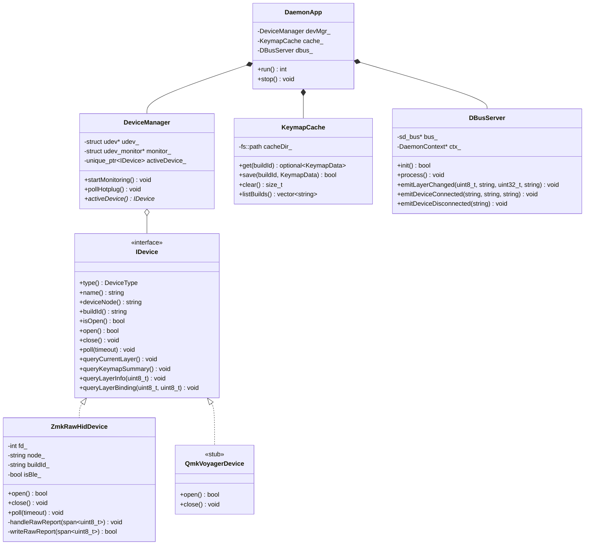

# Implementation Plan: Strata Daemon (`stratad`) & CLI (`strata-cli`)

## Goal Description
Implement Phase 1 of the C++23 Strata architecture in a new repository: `/home/andrii/Projects/pet/strata-daemon`.
The project will produce two standalone binaries:
1. **`stratad`**: A systemd-managed C++23 background daemon that monitors `/dev/hidraw*` devices (Eyelash Corne via ZMK Raw HID over Bluetooth and USB), manages keymap caching in `~/.cache/strata/`, and provides a standard D-Bus interface on the Session Bus (`org.freedesktop.Strata`).
2. **`strata-cli`**: A modern C++23 CLI client that communicates with `stratad` over D-Bus to inspect status, query layers, view keymaps, clear cache, and stream events.

The implementation replaces the Python POC with an extensible hardware abstraction layer (`IDevice`, `ZmkRawHidDevice`, and a `QmkVoyagerDevice` interface stub).

---

## User Review Required
> [!IMPORTANT]
> **Repository Creation & Location**:
> The daemon will be initialized at `/home/andrii/Projects/pet/strata-daemon`.
> The two binaries built will be:
> - `stratad` (Daemon)
> - `strata-cli` (CLI Tool)

> [!NOTE]
> **D-Bus Library Choice**:
> We will use `sd-bus` directly from `libsystemd` (already installed on your system at version 261). This keeps the daemon lean with zero external C++ D-Bus wrapper dependencies while providing native integration with `sd_notify` and `journald`.

---

## Architecture & Class Design



---

## Proposed Changes

### Repository Setup (`/home/andrii/Projects/pet/strata-daemon`)

#### [NEW] `CMakeLists.txt`
- Targets C++23 (`set(CMAKE_CXX_STANDARD 23)`).
- Required packages:
  - `PkgConfig`
  - `libsystemd` (via pkg-config: `systemd >= 250`)
  - `libudev` (via pkg-config: `libudev`)
  - `nlohmann_json` (native system package: `3.12.0`)
- Defines targets:
  - `stratad`: Executable for background daemon.
  - `strata-cli`: Executable for CLI tool.
  - `strata_tests`: Unit test executable using CTest.
- Compiler options: `-Wall -Wextra -Wpedantic -Wconversion -Wshadow`.
- Sanitizer flags configurable via `-DENABLE_SANITIZERS=ON`.

#### [NEW] `Taskfile.yml`
```yaml
version: '3'

tasks:
  build:
    desc: Build all targets with Ninja
    cmds:
      - cmake -B build -G Ninja -DCMAKE_BUILD_TYPE=Release
      - ninja -C build

  debug:
    desc: Build in Debug mode with sanitizers
    cmds:
      - cmake -B build-debug -G Ninja -DCMAKE_BUILD_TYPE=Debug -DENABLE_SANITIZERS=ON
      - ninja -C build-debug

  test:
    desc: Run unit test suite
    cmds:
      - ctest --test-dir build --output-on-failure

  format:
    desc: Format C++ files with clang-format
    cmds:
      - find src tests -name '*.hpp' -o -name '*.cpp' | xargs clang-format -i

  lint:
    desc: Run clang-tidy checks
    cmds:
      - clang-tidy -p build src/**/*.cpp

  install-service:
    desc: Install and activate systemd user service
    cmds:
      - mkdir -p ~/.config/systemd/user ~/.local/share/dbus-1/services
      - cp systemd/stratad.service ~/.config/systemd/user/
      - cp systemd/org.freedesktop.Strata.service ~/.local/share/dbus-1/services/
      - systemctl --user daemon-reload
      - systemctl --user enable --now stratad
```

#### [NEW] `.clang-format` & `.clang-tidy`
- Modern LLVM C++23 rules, 100 character column limit.
- Checks: `modernize-*`, `readability-*`, `bugprone-*`, `performance-*`.

#### [NEW] `.github/workflows/ci.yml`
- GitHub Actions matrix (Ubuntu latest / Arch):
  - Builds with GCC and Clang.
  - Runs `task test`.
  - Runs `clang-format --dry-run` and `clang-tidy`.

---

### Component Implementation

#### 1. Common & Logging Subsystem (`src/common/`)
* **`logger.hpp` / `logger.cpp`**:
  - Detects output mode:
    - If `INVOCATION_ID` or `JOURNAL_STREAM` is set $\rightarrow$ writes with systemd priority tags (`<3>`, `<4>`, `<6>`, `<7>`) or `sd_journal_print`.
    - If TTY $\rightarrow$ prints colored ANSI timestamps and level tags.
  - Respects `STRATAD_LOG_LEVEL=debug|info|warn|error`.
  - **Normal Mode (`INFO`)**: Suppresses repetitive high-frequency layer updates, logs only lifecycle events (startup, device open/close, cache hit/miss, shutdown).
  - **Debug Mode (`DEBUG`)**: Full hex dumps of all raw packets, state machine transitions, and query submissions.
* **`protocol_zmk.hpp`**:
  - Packed C++ structs matching ZMK `protocol.h`:
    - `LayerStateReport` (32 bytes)
    - `KeymapSummaryReport` (32 bytes)
    - `LayerInfoReport` (32 bytes)
    - `LayerBindingReport` (32 bytes)
    - Command builders: `buildCurrentLayerQuery()`, `buildKeymapSummaryQuery()`, `buildLayerInfoQuery()`, `buildLayerBindingQuery()`.
* **`types.hpp`**:
  - Generic domain structures: `Layer`, `KeyBinding`, `KeymapSummary`, `DeviceStatus`.

#### 2. Device Abstraction Layer (`src/device/`)
* **`i_device.hpp`**:
  - Virtual interface for any ergonomic keyboard device.
  - Event callbacks: `onLayerState`, `onSummary`, `onLayerInfo`, `onBinding`, `onDisconnect`.
* **`zmk_raw_hid_device.hpp` / `.cpp`**:
  - Implements `IDevice` for ZMK raw HID over `/dev/hidraw*`.
  - Encapsulates POSIX `open`, non-blocking `select`/`read`, and `write`.
  - Incorporates the **Linux BLE HoG 0x00 dummy report byte logic**:
    - Prepends `0x00` when writing 32-byte queries to `/dev/hidraw`.
    - Reads 32-byte input reports and decodes them via `protocol_zmk.hpp`.
* **`qmk_voyager_device.hpp`**:
  - Interface stub ready for ZSA Voyager QMK raw HID protocol.
* **`device_manager.hpp` / `.cpp`**:
  - Monitors `/dev/hidraw*` via `libudev`.
  - Filters on Raw HID usage page `0xFF60` and usage `0x61`.
  - Dynamically attaches and detaches keyboard instances.

#### 3. Caching Layer (`src/cache/`)
* **`keymap_cache.hpp` / `.cpp`**:
  - Stores persistent JSON files in `~/.cache/strata/keymaps/<device>_<build_id>.json`.
  - Uses `nlohmann::json`.
  - Methods: `load(build_id)`, `save(build_id, data)`, `clear()`, `list()`.

#### 4. D-Bus IPC Subsystem (`src/ipc/`)
* **`dbus_server.hpp` / `.cpp`**:
  - Initializes `sd-bus` connection to the user session bus.
  - Registers object `/org/freedesktop/Strata/Device0` and interface `org.freedesktop.Strata.Device1`.
  - Exposes methods:
    - `GetStatus`
    - `GetLayers`
    - `GetKeymap`
    - `RefreshKeymap`
    - `ClearCache`
  - Emits signals:
    - `LayerChanged(uint32 index, string name, uint32 mask, string build_id)`
    - `DeviceConnected(string name, string node, string build_id)`
    - `DeviceDisconnected(string node)`
    - `KeymapLoaded(string build_id, string source, uint32 layer_count)`
    - `LayerBindingsLoaded(uint32 layer, uint32 count)`
  - Integrates `sd_notify(0, "READY=1")` when D-Bus registration succeeds.

#### 5. Executables
* **`daemon_main.cpp` (`stratad`)**:
  - Installs signal handlers for `SIGINT` and `SIGTERM`.
  - Coordinates `DeviceManager`, `KeymapCache`, and `DBusServer` inside a poll event loop.
  - Automatically queries the active layer on connection and discovers keymap metadata on cache misses.
* **`cli_main.cpp` (`strata-cli`)**:
  - CLI argument parser (`CLI11` or lightweight POSIX getopt).
  - Commands:
    - `strata-cli status [--json]`
    - `strata-cli layers [--json]`
    - `strata-cli keymap [--layer N] [--refresh] [--all] [--json]`
    - `strata-cli cache [--clear] [--json]`
    - `strata-cli listen [--json]` (streams live D-Bus signals)

#### 6. Systemd & Udev Services (`systemd/`)
* **`systemd/stratad.service`**:
  ```ini
  [Unit]
  Description=Strata Keyboard Management Daemon
  Documentation=https://github.com/lebedenko/strata
  After=graphical-session.target

  [Service]
  Type=notify
  ExecStart=/usr/local/bin/stratad
  Restart=on-failure
  RestartSec=2s
  Environment=STRATAD_LOG_LEVEL=info

  [Install]
  WantedBy=default.target
  ```
* **`systemd/org.freedesktop.Strata.service`**:
  D-Bus auto-activation unit so any client or script can trigger daemon launch automatically.
* **`udev/99-strata.rules`**:
  Ensures `/dev/hidraw*` devices for Eyelash Corne (`1d50:615e`) and ZSA Voyager (`3297:1977`) have user read/write permissions (`TAG+="uaccess"`).

---

## Verification Plan

### Automated Tests
1. **CTest Suite**:
   ```bash
   cd /home/andrii/Projects/pet/strata-daemon
   task test
   ```
   - `test_protocol`: Verifies binary struct alignment, pack/unpack, and little-endian conversions against `protocol.h`.
   - `test_cache`: Verifies JSON file serialization, deserialization, and cache eviction.
   - `test_device_mock`: Verifies the query state machine and request/response sequence using a virtual loopback device.
2. **Lint & Formatting**:
   ```bash
   task format
   task lint
   ```

### Manual Verification on Live Hardware
1. **Direct Terminal Run**:
   ```bash
   ./build/stratad
   ```
   Verify colored logs show `Connected to /dev/hidraw4`, query sent, keymap summary received, and layer metadata cached.
2. **D-Bus Communication via `strata-cli`**:
   ```bash
   ./build/strata-cli status
   ./build/strata-cli layers
   ./build/strata-cli keymap --layer 0
   ./build/strata-cli listen
   ```
   Switch layers on the physical keyboard; verify `LayerChanged` events stream in real time.
3. **Generic D-Bus Introspection**:
   ```bash
   busctl --user introspect org.freedesktop.Strata /org/freedesktop/Strata/Device0
   ```
4. **Systemd Service & Journald**:
   ```bash
   task install-service
   journalctl --user -u stratad -f
   ```
   Verify logs are concise in normal mode and verbosely detailed when `STRATAD_LOG_LEVEL=debug` is set.
